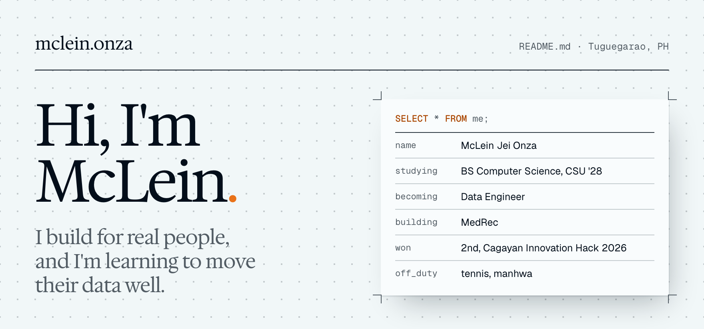
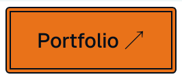
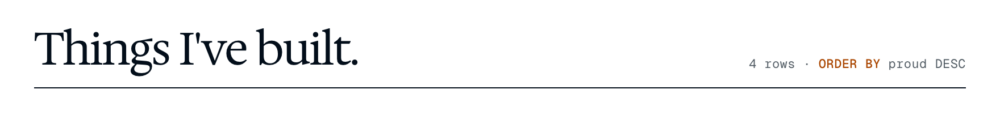
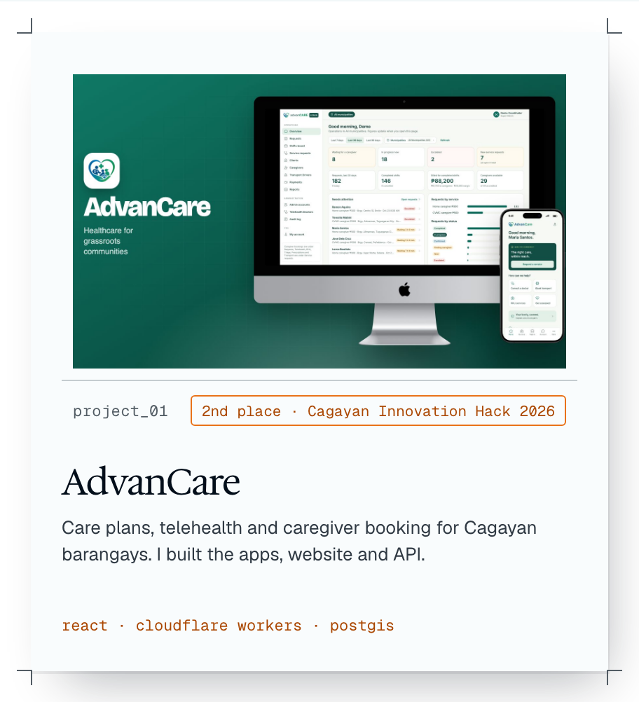
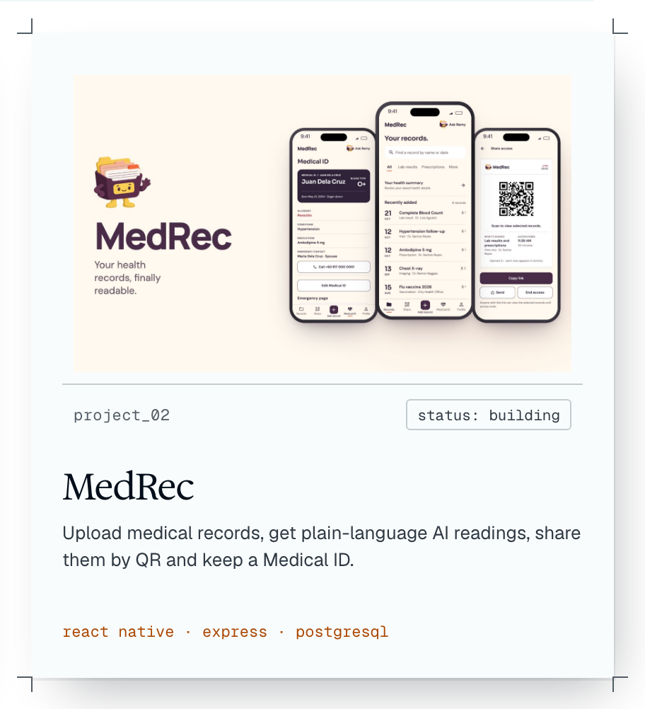
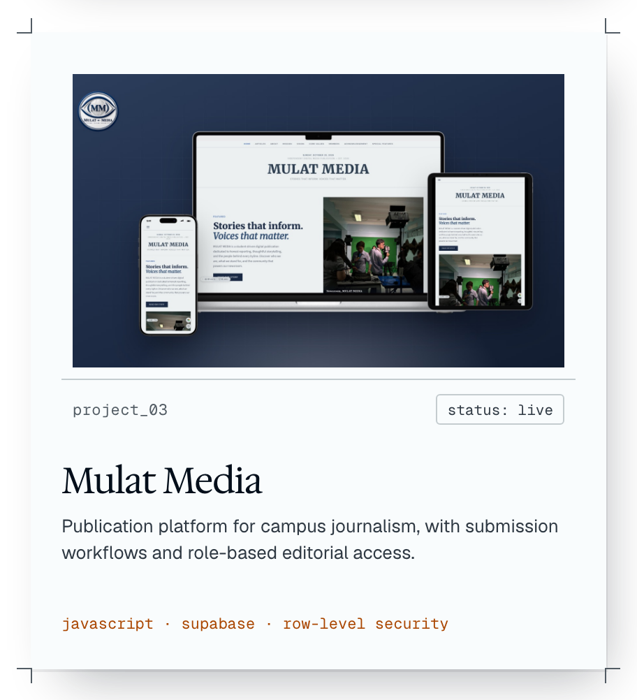
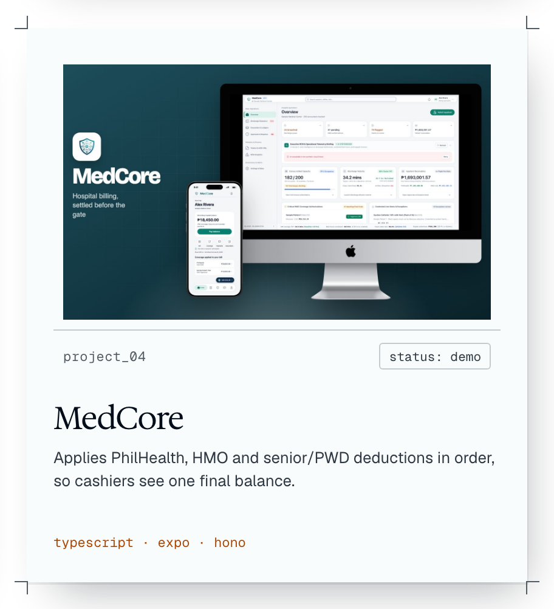
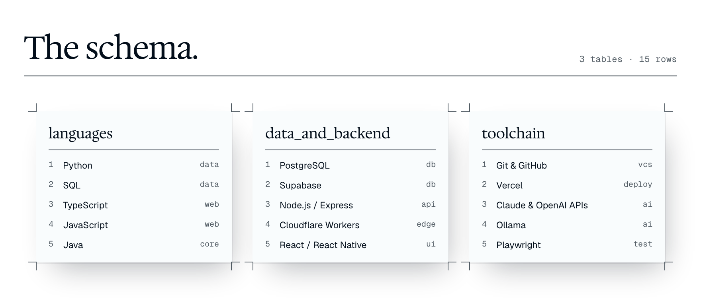
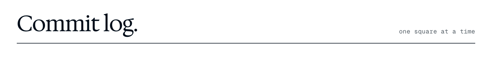
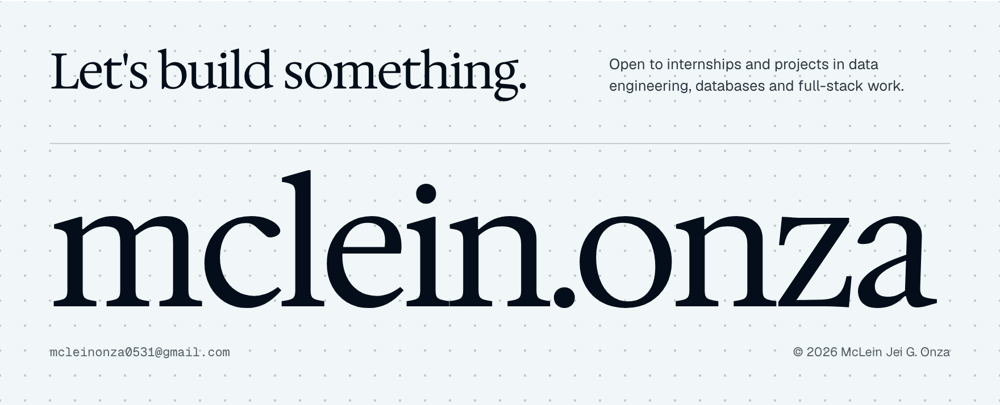

<picture>
  <source media="(prefers-color-scheme: dark)" srcset="assets/header-dark.png">
  
</picture>

  <a href="https://onzamj.vercel.app/"><picture><source media="(prefers-color-scheme: dark)" srcset="assets/btn-portfolio-dark.png"></picture></a>
  <a href="mailto:mcleinonza0531@gmail.com"><picture><source media="(prefers-color-scheme: dark)" srcset="assets/btn-email-dark.png"></picture></a>
  <a href="https://www.linkedin.com/in/mclein-jei-onza-9b0769322/"><picture><source media="(prefers-color-scheme: dark)" srcset="assets/btn-linkedin-dark.png"></picture></a>

<picture>
  <source media="(prefers-color-scheme: dark)" srcset="assets/work-head-dark.png">
  
</picture>

  <a href="https://onzamj.vercel.app/#work"><picture><source media="(prefers-color-scheme: dark)" srcset="assets/card-advancare-dark.png"></picture></a>
  <a href="https://github.com/Mclein31/MedRec"><picture><source media="(prefers-color-scheme: dark)" srcset="assets/card-medrec-dark.png"></picture></a>
  <a href="https://mulat-media.vercel.app/"><picture><source media="(prefers-color-scheme: dark)" srcset="assets/card-mulat-dark.png"></picture></a>
  <a href="https://onzamj.vercel.app/#work"><picture><source media="(prefers-color-scheme: dark)" srcset="assets/card-medcore-dark.png"></picture></a>

<picture>
  <source media="(prefers-color-scheme: dark)" srcset="assets/stack-dark.png">
  
</picture>

<picture>
  <source media="(prefers-color-scheme: dark)" srcset="assets/activity-head-dark.png">
  
</picture>

<picture>
  <source media="(prefers-color-scheme: dark)" srcset="https://raw.githubusercontent.com/Mclein31/Mclein31/output/github-contribution-grid-snake-dark.svg">
  
</picture>

<a href="https://onzamj.vercel.app/"><picture>
  <source media="(prefers-color-scheme: dark)" srcset="assets/footer-dark.png">
  
</picture></a>
